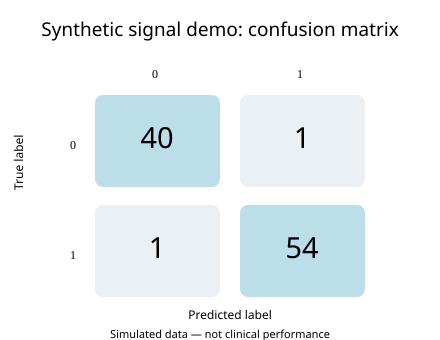

# BioSignal Lab

[](https://github.com/jaykrukar/biosignal-lab/actions/workflows/tests.yml)

Reproducible **synthetic** biomedical-style waveform classification using Python, SciPy, and scikit-learn. Focus: data generation, feature extraction, patient/subject-aware splits, explicit metrics, and tests.

> **Scope:** This repository does **not** process real ECG/EEG recordings and is **not** a medical device, clinical classifier, or validated PhysioNet submission. Pulse-like signals are artificial and intentionally simplified.

## Try it

```bash
python -m pip install -e '.[dev]'
python -m biosignal_lab --seed 17 --out artifacts
python -m pytest -q
```

Outputs: `artifacts/demo_report.json` and `artifacts/confusion_matrix.png`.

Actual generated example report: [docs/demo_report.json](docs/demo_report.json).



## What is being evaluated?

1. Generate multiple pulse-like segments per simulated subject using a fixed random seed.
2. Extract finite waveform statistics and inter-peak features.
3. Split by **subject ID**, not individual segment, using `GroupShuffleSplit`.
4. Fit a modest `RandomForestClassifier` on training subjects only.
5. Measure held-out accuracy, macro F1, and confusion matrix.
6. Assert that training and test subject IDs never overlap.

### Why group-aware validation?

Segments from the same person can share subject-specific patterns. Randomly splitting segments would leak this identity signal, inflating evaluation scores. This demo uses explicitly simulated subjects to exercise the correct pattern.

## Structure

- `src/biosignal_lab/signals.py` — seeded synthetic waveform generator.
- `src/biosignal_lab/features.py` — statistical and peak-derived features.
- `src/biosignal_lab/train.py` — grouped train/test split and metrics.
- `src/biosignal_lab/cli.py` — reproducible reports and visualization.
- `tests/` — reproducibility, input validation, shape checks, leakage checks.

## Extensions for a serious biomedical ML portfolio

Load a **specific** public PhysioNet dataset under its license, document cohort selection, use genuine subject IDs, report class prevalence, add calibration and confidence intervals, and discuss model limitations. Do not quote synthetic demo metrics as real-world biomedical performance.

## Provenance

Initial implementation scaffolded with AI assistance. Execute, review, and extend it before claiming individual engineering competence. License: MIT.
